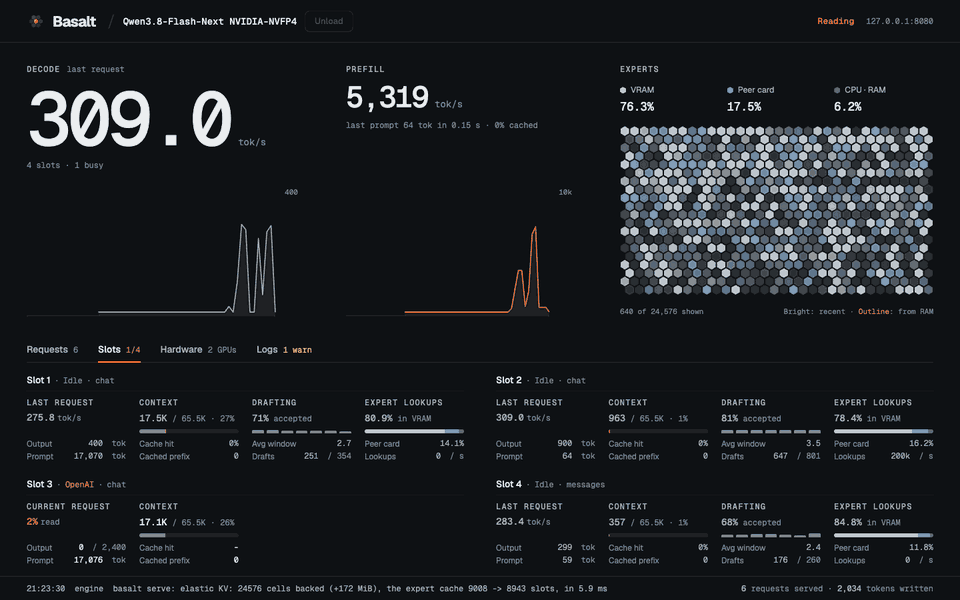

# Amperite

Amperite is a fork of [Adamant](https://github.com/nixcat-dev/adamant) (sm_89), which forks [Basalt](https://github.com/jesdga95/basalt)
(sm_120), itself based on Strata: a local inference engine for large mixture-of-experts models (**Hy4-flash**,
**Qwen3.8-Flash-Next**, **Inkling 2 Mini**) built for NVIDIA **Ampere** (RTX 30-series, sm_86) GPUs only.

> **Status: early development.** Expect breakage; flags, defaults and the pack layout can still change. The numbers below
> are development runs on one card, not the maintainer's headline numbers. Open validation work is listed in
> [Ampere execution and validation](docs/precision/ampere.md). Linux and Windows platform support is retained.

Experts that do not fit in VRAM live in system RAM, and optionally on a second GPU used as a peer expert tier.
A large MoE model runs on one workstation, behind an OpenAI- and Anthropic-compatible API.

<p align="center"></p>

<p align="center">
  <a href="https://github.com/sponsors/artiik373"></a>
  <a href="https://www.paypal.com/donate/?hosted_button_id=6JDA4WJHY9Y58"></a>
</p>

## What this fork adds

- **One target, sm_86.** `include/basalt/cuda_target.hpp` decides the compute capability. Upstream's Hopper and Blackwell
  paths (thread-block clusters, tensor maps, programmatic dependent launch, native FP4/FP8 block-scaled MMA) are ported to
  sm_86 or left out ([Ampere execution](docs/precision/ampere.md)).
- **Upstream Basalt merged through the 0.5.7 line**, without the deepseek41 model and the sm_120a paths.
- **Inkling 2 Mini on sm_86**: upstream's model with its TMA copies replaced by `cp.async`, MXFP8 products emulated on
  fp16 MMA, and NVFP4 experts on the integer MMQ path ([guide](docs/models/inkling2.md)).
- **LoopCD for Inkling 2** (`--loopcd hidden:W | logits:W | adaptive:WMAX`, off by default): training-free contrastive
  decoding between the loop's last and first pass, after [arXiv 2610.02185](https://arxiv.org/abs/2610.02185), with a
  plausibility mask on the logit forms ([precision](docs/precision/inkling2.md#loopcd)).
- **Trellis weights**: EXL3 (QTIP trellis) tensors on the CPU and the GPU, and the MS (Mad Shift) 1MAD trellis format with
  its converter in `tools/convert/` for Qwen3.8-Flash-Next ([MS trellis](docs/ms-trellis-qwen4exp.md),
  [MS pack precision](docs/precision/ms-pack.md)).
- **A second Hy4-flash engine** (`hy4`): packs built locally from a `hy_v4_flash` GGUF, with the DFly2 drafter.

## Requirements

- Linux x86-64 with AVX2 (AVX-512 is used when present), or Windows 10 1903+ x64 ([platforms](docs/platforms.md)).
- An NVIDIA Ampere (compute capability 8.6) GPU with CUDA 13.
- CMake 3.24 or newer, GCC 13 or newer (Linux), Python 3.10 or newer, and enough system RAM for the experts that do not fit in VRAM.

## Quick start

```sh
git clone https://github.com/Artiik373/amperite && cd amperite
cmake -S . -B build -DCMAKE_BUILD_TYPE=Release
cmake --build build -j                  # bin/basalt, bin/basalt-bench, bin/basalt-probe, bin/basalt-vision
                                        # Windows: add -G Ninja to the first line, from an x64 VS 2022 prompt ([platforms](docs/platforms.md#building-on-windows))
                                        # some models only: -DBASALT_MODELS="qwen4exp;inkling2" (from qwen4exp, hy4flash, hy4, inkling2; [building](docs/building.md#building-only-some-models))
pip install -r requirements.txt
hf download jesdga/Qwen3.8-Flash-Next-Basalt Qwen3.8-FN-GSQ-RCO-IQ3_S.basalt --local-dir models
```

The build targets sm_86; `-DCMAKE_CUDA_ARCHITECTURES` accepts only `86`. What the port changes against upstream and what is still open is in
[Ampere execution and validation](docs/precision/ampere.md).

The binary and file-format names stay `basalt` and `.basalt`: the packs are the
same files Basalt reads, so a fork that renamed them would break every existing
model. Amperite is the project name, not a new format.

Put your settings in `basalt_config.json`: the `models` list names the packs, and each entry's own `gpu` and `kv` win over the
top-level `engine` block ([models and the router](docs/configuration/models.md)):

```json
{
  "version": 2,
  "models": [{ "model": "models/Qwen3.8-FN-GSQ-RCO-IQ3_S.basalt", "gpu": "0,1", "gpu-mode": "peer", "kv": "int8" }],
  "engine": { "expert-cache": "auto", "prefill": "auto", "resident-experts": true },
  "server": { "port": 8080 }
}
```

```sh
bin/basalt serve --config basalt_config.json
```

The server listens on 127.0.0.1. Every setting: [configuration](docs/configuration/index.md). More examples:
[example configurations](docs/configuration/examples.md).

## Measured on Ampere

Development measurements, not the maintainer's headline runs: one RTX 3090 (24 GB) at a **304 W** power limit,
`basalt-bench` fixtures, expert cache auto, the rest of the experts in page-locked RAM.

| Pack | Prefill 16k | Decode conv | struct | prose |
| --- | ---: | ---: | ---: | ---: |
| Hy4-flash AD-IQ2_S-IQ2_XXS, DFly2 drafter on | 1,377 t/s | 50 tok/s | 81 tok/s | 46 tok/s |

Draft acceptance 70%, 99.9% and 58%: the spread is drafting acceptance per content, not engine speed.

Upstream Adamant measured on an RTX 4090 (sm_89) at 450 W, with the GSQ-RCO IQ3_S Qwen3.8-Flash-Next pack and int8 KV, MTP drafter off → on: conv 115 → 190,
struct 116 → 372, prose 116 → 169 tok/s. Its Adamant-versus-Strata comparison from those runs is in
[the comparison report](docs/benchmarks/strata-comparison.md).

## Models

| | Hy4-flash | Qwen3.8-Flash-Next | Inkling 2 Mini |
|---|---|---|---|
| Packs | built locally from a `hy_v4_flash` GGUF with `tools/convert/convert.py --hf-dir` ([pack](docs/models/hy4-flash/pack.md)) | [Hugging Face](https://huggingface.co/jesdga/Qwen3.8-Flash-Next-Basalt) | `Inkling-2-Mini-NVFP4-MX8`, [Hugging Face](https://huggingface.co/jesdga/Inkling-2-Mini-Basalt) |
| Context | default 8,192; `--max-context` sets it | default 8,192; `--max-context` sets it | default 8,192; `--max-context` sets it, up to 1,048,576 |
| Drafting | DFly2 drafter, appended with `convert.py --dfly FILE --into PACK`; `--spec` default 6 | MTP drafter in the pack, on; `--spec` default 8 | DSpark drafter in the pack, on; `--spec` default 8 |
| Guide | [guide](docs/models/hy4-flash.md) | [guide](docs/models/qwen38-flash-next.md) | [guide](docs/models/inkling2.md) |
| Precision | [precision](docs/precision/hy4-flash.md) | [precision](docs/precision/qwen38-flash-next.md) | [precision](docs/precision/inkling2.md) |

All models compared, with each one's context limit, flags and cards: [models](docs/models/index.md).

## Video

Qwen3.8-Flash-Next reads video; Hy4-flash does not. A video is named like an image in a chat message, and needs
`--vision` and FFmpeg on the machine. Flash-Next decodes frames on the GPU with NVDEC; the 27B decodes them on the CPU.
How a request names a video, and the limits: [video](docs/running.md#video).

On Ampere the NVFP4 packs run through the integer MMQ path rather than native FP4
tensor instructions, so their numerics differ from a Blackwell run; the IQ and K-quant
formats use the same kernels as upstream. A pack can be built locally from a GGUF, drafter included
([model file](docs/model-file.md), [Ampere execution](docs/precision/ampere.md)).

## Documentation

- **Run:** [running](docs/running.md), [configuration](docs/configuration/index.md), [models and the router](docs/configuration/models.md),
  [sampling](docs/configuration/sampling.md), [image sources](docs/configuration/image-sources.md),
  [documents](docs/configuration/documents.md),
  [diagnostics](docs/configuration/diagnostics.md), [basalt-probe](docs/probe.md), [platforms](docs/platforms.md).
- **Models:** [models](docs/models/index.md), [Hy4-flash](docs/models/hy4-flash.md), [Flash-Next](docs/models/qwen38-flash-next.md),
  [Inkling 2 Mini](docs/models/inkling2.md), [MS trellis](docs/ms-trellis-qwen4exp.md), [the `.basalt` file](docs/model-file.md), [file format changes](docs/basalt-file-changelog.md).
- **Quality:** [precision](docs/precision/index.md), [method](docs/precision/quality.md), [Ampere port](docs/precision/ampere.md).
- **Build and develop:** [building](docs/building.md), [adding a model](docs/adding-a-model.md), [community runs](docs/community.md),
  [changelog](docs/changelog/index.md), [contributing](CONTRIBUTING.md).

## Credits

Code:

- [Adamant](https://github.com/nixcat-dev/adamant): the project Amperite forks (MIT).
- [Basalt](https://github.com/jesdga95/basalt): the project upstream Adamant forks (MIT). Its later lines are merged in.
- [Strata](https://github.com/Niko1221/Strata): the project Basalt forks (MIT).
- [ggml and llama.cpp](https://github.com/ggml-org/llama.cpp): quantization formats, kernels, the GBNF grammar engine and
  the Qwen pre-tokenizer, extracted into `src/` (MIT).
- [Infernix](https://github.com/Wallawalla47/Infernix): ideas and code for the int8 prompt-attention kernel (Apache-2.0).
- [ninfer](https://github.com/Neroued/ninfer): ideas for the video input (Apache-2.0).
- [stb_image](https://github.com/nothings/stb) for image decoding, and [FFmpeg](https://ffmpeg.org) declarations for video.

The licenses and the parts each project covers: [THIRD_PARTY_LICENSES](THIRD_PARTY_LICENSES).

Models and methods:

- [Qwen](https://huggingface.co/Qwen/Qwen3.8-Flash-Next): Qwen3.8-Flash-Next and Qwen3.8-27B. Their packs are under the
  [Qwen Community License 1.0](https://huggingface.co/Qwen/Qwen3.8-Flash-Next/blob/main/LICENSE), not this MIT license.
- Tencent: Hy4-flash, under the Tencent Hy License 1.0.
- Thinking Machines Lab: Inkling 2 Mini and its DSpark drafter (Apache-2.0).
- [unsloth](https://huggingface.co/unsloth): the UD and Q8_0 GGUFs the packs are built from.
- IST Austria DAS Lab: the GSQ-RCO quants; please cite [GSQ](https://arxiv.org/abs/2604.18556) and [RCO](https://arxiv.org/abs/2605.00649).
- [NVIDIA](https://huggingface.co/nvidia/Qwen3.8-Flash-Next-NVFP4): the NVFP4 experts.
- [QTIP](https://arxiv.org/abs/2406.11235) and [exllamav3](https://github.com/turboderp-org/exllamav3): the trellis
  quantization that the EXL3 tensors use, and the qbench prompts and harness that the quality gate matches.
- [LoopCD](https://arxiv.org/abs/2610.02185) (Liu et al., "Decoding Looped Transformers Better for (Almost) Free"): the
  method behind `--loopcd`.

## License

MIT, see [LICENSE](LICENSE).
